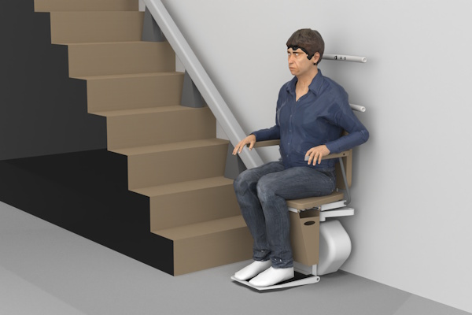
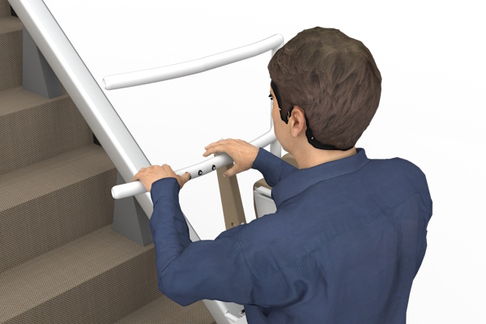
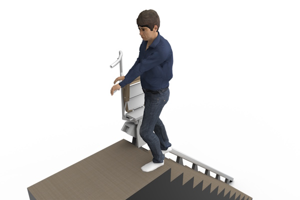
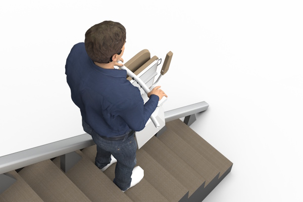

# Adapt Stairlift

**Innovative stairlift enhancements for improved mobility, safety, and independence.**  
Major project by George Barrass, University of Nottingham.

---

## Table of Contents

- [Adapt Stairlift](#adapt-stairlift)
  - [Table of Contents](#table-of-contents)
  - [Project Overview](#project-overview)
  - [Demo](#demo)
  - [Screenshots](#screenshots)
  - [Accessibility](#accessibility)
  - [License](#license)
  - [Contact](#contact)

---

## Project Overview

**Adapt Stairlift** is a set of modular enhancements designed to improve the functionality, safety, and user experience of existing stairlift designs. Instead of replacing core components, these adaptations can be integrated by stairlift manufacturers with minimal modification.

The project addresses real-world needs, focusing on:
- Safe transport of personal items during stairlift use.
- User reluctance due to perceived loss of independence.

---

## Demo

You can try the site by downloading the files and opening `index.html` in your browser.

---

## Screenshots

|  |  |
|:--:|:--:|
| *Seated stairlift at base of stairs* | *User gripping assist bar* |

|  |  |
|:--:|:--:|
| *User reaching top of stairs* | *User descending with assist bar* |

*(See more in the in-app carousel.)*

---

## Accessibility

- Semantic HTML with descriptive alt text for all images.
- High-contrast text over images for readability.
- Responsive layout for desktop and mobile devices.
- Lightbox navigation supports keyboard and touch controls.

---

## License

This project is licensed under the terms of the included [LICENSE](LICENSE) file.

---

## Contact

Through github only

---

*Designed May 2025 | University of Nottingham | Product Design and Manufacture BEng*
